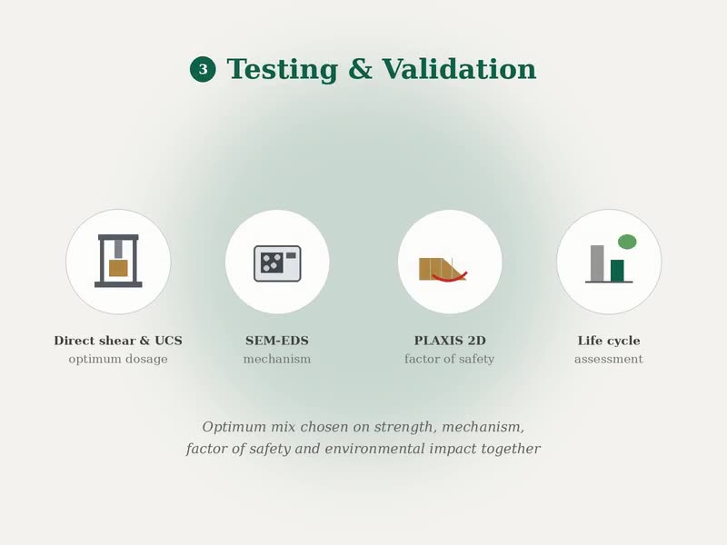
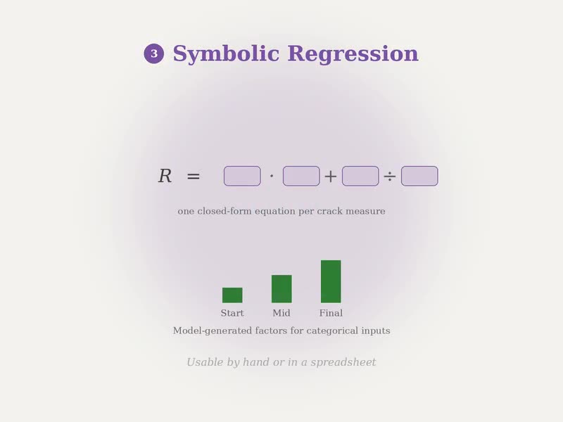
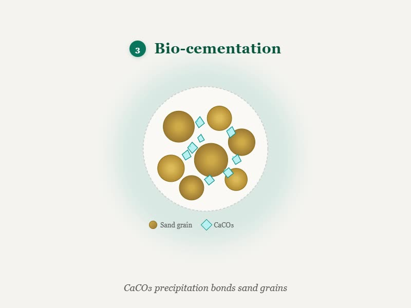

I'm a Lecturer in the Department of Civil Engineering at Leading University, Sylhet. I did my B.Sc. in Civil and Environmental Engineering at SUST in 2024, and I'm looking for a graduate position.

Most of my work so far has been in the lab. I've worked on stabilizing weak soils with fiber, fly ash, lime, crushed glass, farm waste and even a cyanobacterium. A lot of it came from problems close to home, like the embankments in Sunamganj that crack every dry season.

After graduating, I started working with numerical models and machine learning. Teaching slope stability got me there. Many data-driven slope models I read about gave answers that went against basic soil mechanics, so I built one that can't. I'm now doing something similar for desiccation cracking.

## Research Interests

<ul class="icon-list">
<li><i class="fas fa-fw fa-layer-group"></i> Soil stabilization and ground improvement</li>
<li><i class="fas fa-fw fa-bacterium"></i> Biostabilization and MICP</li>
<li><i class="fas fa-fw fa-house-flood-water"></i> Geohazard assessment and mitigation</li>
<li><i class="fas fa-fw fa-brain"></i> Physics-informed and Bayesian machine learning</li>
<li><i class="fas fa-fw fa-chart-area"></i> Uncertainty quantification and surrogate modelling</li>
<li><i class="fas fa-fw fa-recycle"></i> Waste materials in geotechnical construction</li>
</ul>

## News

<ul class="news">
<li>Sep 2026 Finished the IEB training on drone applications in civil engineering.</li>
<li>Aug 2026 Wrapped up the Bayesian PINN slope stability study. Writing the paper now.</li>
<li>Jul 2026 Started my CRISP-funded project on zeolite and cellulose fiber in embankment soil, as PI.</li>
<li>Jun 2026 Started modelling desiccation cracking with gradient boosting and symbolic regression.</li>
<li>2026 Three papers under review, including my first-author <em>Arthrospira platensis</em> paper in <em>Geosystems and Geoenvironment</em>.</li>
<li>Oct 2025 Joined Leading University as a full-time Lecturer.</li>
</ul>

## Selected Work

<a class="work-card" href="/research-projects/slope-stability/">

Slope stability prediction with Bayesian PINNs

<i class="fas fa-pen-nib"></i> Paper in preparation

</a>
<a class="work-card" href="/research-projects/zeolite-cellulose/">

Zeolite and cellulose fiber in embankment soil

<i class="fas fa-user-tie"></i> PI, funded by CRISP

</a>
<a class="work-card" href="/research-projects/desiccation-ml/">

Machine learning and equations for desiccation cracking

<i class="fas fa-spinner"></i> Ongoing

</a>
<a class="work-card" href="/research-projects/bio-cementation/">

Bio-cementation of sand with <em>Arthrospira platensis</em>

<i class="fas fa-file-lines"></i> First author, under review

</a>

All my projects are on the [research](/research-projects/) page and my papers are on the [publications](/publications/) page.

<i class="fas fa-envelope"></i> If you think my work fits your group, email me at <a href="mailto:n.hasnat_ce@lus.ac.bd">n.hasnat_ce@lus.ac.bd</a>. I can share the papers that are still under review.

