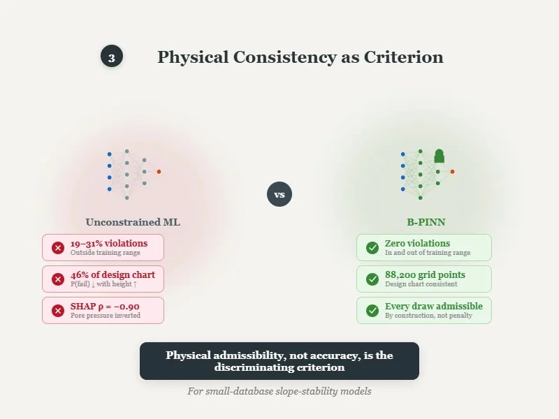
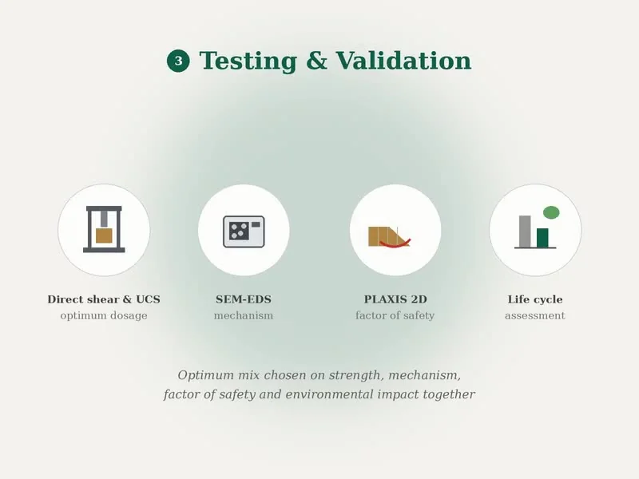
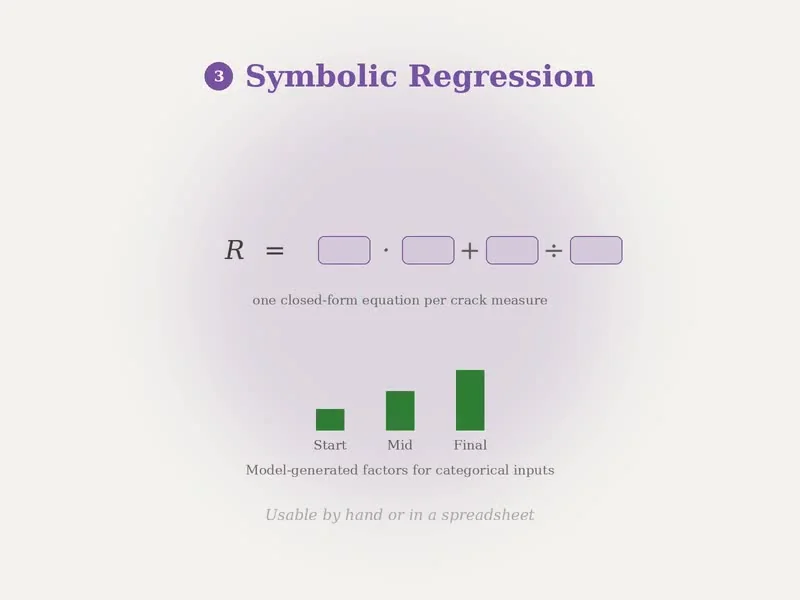
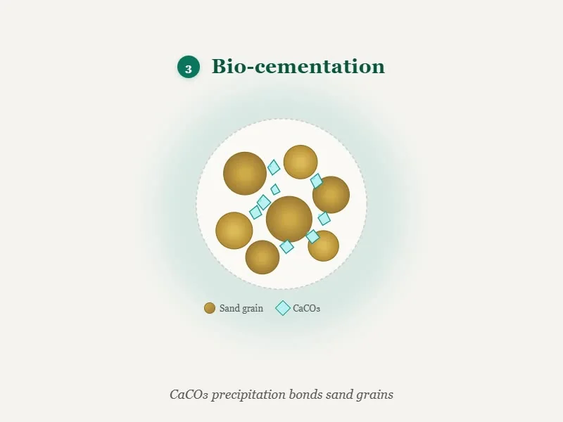

I am a Lecturer in the Department of Civil Engineering at Leading University, Sylhet, Bangladesh. I received my B.Sc. in Civil and Environmental Engineering from Shahjalal University of Science and Technology (SUST) in 2024, graduating with a CGPA of 3.76 out of 4.00. I am currently looking for a graduate position.

My research is in geotechnical engineering, and it follows two connected lines. The first is experimental. As a Research and Technical Assistant at SUST from 2022 to 2024, I carried out the laboratory work for four funded soil stabilization projects. These studies looked at crushed waste glass, fly ash, polyester and waste plastic fiber, lime, rice husk ash and eggshell powder as additives for weak soils. My undergraduate thesis examined microbially induced carbonate precipitation using the cyanobacterium *Arthrospira platensis*, an approach that has seen little use in Bangladesh.

The second line is computational. While teaching slope stability, I noticed that many published machine learning models for slopes produce predictions that contradict basic soil mechanics. To address this, I developed a Bayesian physics-informed neural network that cannot violate these physical trends, pretrained on PLAXIS 2D simulations generated through automated scripting. I am now applying gradient boosting and symbolic regression to identify the main factors that control desiccation cracking in embankment soils.

I am also the Principal Investigator of a project funded by the Centre for Research, Innovative Studies and Planning (CRISP), Leading University, which tests natural zeolite and cellulose fiber as low-carbon stabilizers for embankment soil. The project combines a drone survey, laboratory testing, finite element modelling and life cycle assessment.

## <i class="fas fa-graduation-cap"></i> At a Glance

2Journal articles

3Manuscripts under review

3Conference papers

5Funded projects

2Years of teaching

<ul class="icon-list">
<li><i class="fas fa-fw fa-briefcase"></i> <strong>Lecturer</strong>, Department of Civil Engineering, Leading University (October 2025 to present); Adjunct Lecturer (November 2024 to October 2025)</li>
<li><i class="fas fa-fw fa-flask"></i> <strong>Research and Technical Assistant</strong>, Department of Civil and Environmental Engineering, SUST (June 2022 to August 2024)</li>
<li><i class="fas fa-fw fa-graduation-cap"></i> <strong>B.Sc. in Civil and Environmental Engineering</strong>, SUST (2024), CGPA 3.76/4.00</li>
<li><i class="fas fa-fw fa-award"></i> <strong>Principal Investigator</strong>, CRISP research grant, Leading University (2026)</li>
</ul>

## <i class="fas fa-microscope"></i> Research Interests

<ul class="icon-list">
<li><i class="fas fa-fw fa-layer-group"></i> Soil stabilization and ground improvement</li>
<li><i class="fas fa-fw fa-bacterium"></i> Biostabilization and MICP</li>
<li><i class="fas fa-fw fa-house-flood-water"></i> Geohazard assessment and mitigation</li>
<li><i class="fas fa-fw fa-brain"></i> Physics-informed and Bayesian machine learning</li>
<li><i class="fas fa-fw fa-chart-area"></i> Uncertainty quantification and surrogate modelling</li>
<li><i class="fas fa-fw fa-recycle"></i> Waste materials in geotechnical construction</li>
</ul>

## <i class="far fa-newspaper"></i> News

<ul class="news">
<li>Sep 2026 Completed the IEB training on applications of drone technology in civil engineering.</li>
<li>Aug 2026 Completed the Bayesian PINN slope stability study. The manuscript is in preparation.</li>
<li>Jul 2026 Began the CRISP-funded project on zeolite and cellulose fiber stabilization of embankment soil, as Principal Investigator.</li>
<li>Jun 2026 Began modelling desiccation cracking with gradient boosting and symbolic regression.</li>
<li>2026 Three manuscripts under review, including my first-author <em>Arthrospira platensis</em> study in <em>Geosystems and Geoenvironment</em>.</li>
<li>Oct 2025 Appointed Lecturer in the Department of Civil Engineering, Leading University.</li>
</ul>

## <i class="fas fa-star"></i> Selected Work

<a class="work-card" href="/research-projects/slope-stability/">

Slope stability prediction with Bayesian PINNs

<i class="fas fa-pen-nib"></i> Paper in preparation

</a>
<a class="work-card" href="/research-projects/zeolite-cellulose/">

Zeolite and cellulose fiber in embankment soil

<i class="fas fa-user-tie"></i> PI, funded by CRISP

</a>
<a class="work-card" href="/research-projects/desiccation-ml/">

Machine learning and equations for desiccation cracking

<i class="fas fa-spinner"></i> Ongoing

</a>
<a class="work-card" href="/research-projects/bio-cementation/">

Bio-cementation of sand with <em>Arthrospira platensis</em>

<i class="fas fa-file-lines"></i> First author, under review

</a>

A full list of projects is on the [research](/research-projects/) page, and all papers are on the [publications](/publications/) page.

<i class="fas fa-envelope"></i> If my work aligns with your group's research, I would welcome the chance to discuss it. You can reach me at <a href="mailto:n.hasnat_ce@lus.ac.bd">n.hasnat_ce@lus.ac.bd</a>. Manuscripts under review are available on request.

