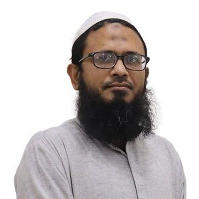
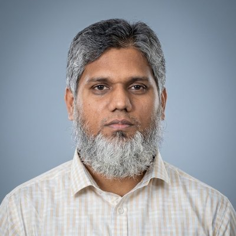
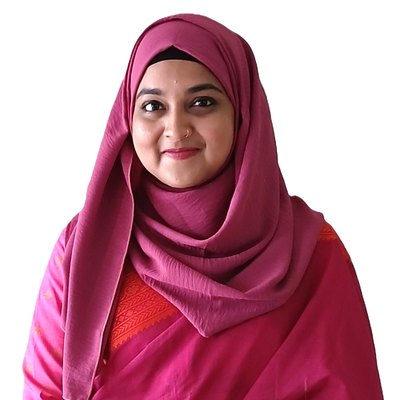
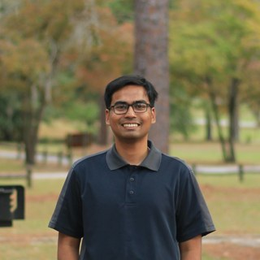
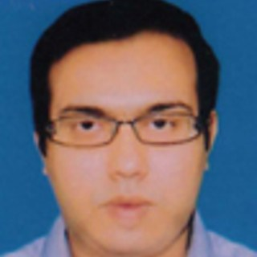

My research has been shaped by the people I have worked alongside. I joined Dr. Shriful Islam's research group at SUST in 2022 as an undergraduate, and that group is where I learned to plan experiments, build test setups and write for publication. Dr. Mohammad Shahidur Rahman then gave me the freedom to take on a biological approach to soil stabilization for my thesis. The friends I made in that group are still my closest collaborators, and since joining Leading University I have also had the guidance of senior colleagues in teaching and engineering practice. Many of these collaborations are ongoing.

## Supervisors

Dr. Mohammad Shahidur Rahman

Professor and Head, Department of Civil and Environmental Engineering, SUST

Dr. Rahman supervised my undergraduate thesis on bio-cementation of sand using <em>Arthrospira platensis</em>, a pilot study in an area that is rarely attempted in Bangladesh. I helped write the proposal that secured funding from the SUST Research Centre and prepared the final report. Alongside the thesis, I worked as a Technical Assistant on his project, developing and installing custom laboratory equipment. He remains my co-author on the journal manuscript and on a review of MICP that we are preparing together.

<a href="https://www.sust.edu/departments/cee/faculty/msrahman-cee@sust.edu"><i class="fas fa-building-columns"></i> Faculty page</a>
<a href="https://orcid.org/0009-0002-1862-2978"><i class="ai ai-orcid"></i> ORCID</a>

Dr. Shriful Islam

Professor, Department of Civil and Environmental Engineering, SUST

I joined Dr. Islam's research group in 2022, and it is where most of my experimental training took place. Under his supervision I worked on crushed glass and fly ash in pavement subgrade, on fiber and fly ash against desiccation cracking in embankment soil, and on lime, rice husk ash and eggshell powder for silty soil. These projects led to my two journal articles and further manuscripts. I have continued to work with him since graduating.

<a href="https://www.sust.edu/departments/cee/faculty/sharif-cee@sust.edu"><i class="fas fa-building-columns"></i> Faculty page</a>
<a href="https://orcid.org/0000-0002-8148-4750"><i class="ai ai-orcid"></i> ORCID</a>

## Collaborators and Colleagues

Ananya Soheli Chowdhury

Lecturer, Department of Civil and Environmental Engineering, SUST

Ananya has been part of my research from the very beginning, and she is a close friend as well as a fellow researcher. We have worked together on the crushed glass and fly ash study, the desiccation cracking work in both its conference and journal forms, the lime, rice husk ash and eggshell powder study, and the waste plastic fiber, fly ash and lime study on haor embankment soil.

<a href="https://www.sust.edu/departments/cee/faculty/ananya-cee@sust.edu"><i class="fas fa-building-columns"></i> Faculty page</a>
<a href="https://orcid.org/0009-0009-5338-8276"><i class="ai ai-orcid"></i> ORCID</a>

Junaidul Islam

PhD student, Geotechnical Engineering, Auburn University

Junaidul has been like an older brother to me in research. He was the first to notice my work and bring me into his research, and we have stayed in close contact ever since. Together we have carried out field surveys, built and run custom test setups, and co-authored the crushed glass papers in <em>Heliyon</em> and at ICCESD 2024, the desiccation cracking papers in <em>Geotechnical and Geological Engineering</em> and at ICACE 2024, and the two stabilization manuscripts currently under review.

<a href="https://www.linkedin.com/in/junaidulislam-sust-bd/"><i class="fab fa-linkedin"></i> LinkedIn</a>
<a href="https://orcid.org/0000-0002-9415-8962"><i class="ai ai-orcid"></i> ORCID</a>

Raied Ahmed Nishat

Civil engineering researcher, Georgia Southern University

Nishat was my junior at SUST, and we later worked together briefly at Leading University. We are now joint first authors on the Bayesian physics-informed neural network study for slope stability, which brings together automated finite element modelling and machine learning.

<a href="https://www.linkedin.com/in/raiedahmed"><i class="fab fa-linkedin"></i> LinkedIn</a>
<a href="https://orcid.org/0009-0006-0448-3486"><i class="ai ai-orcid"></i> ORCID</a>

Amit Chakraborty

Assistant Professor and Head (Acting), Department of Civil Engineering, Leading University

Mr. Chakraborty has been my professional supervisor at Leading University. He has guided and mentored me both as an educator and in engineering practice, drawing on his experience as one of the leading structural engineers in Sylhet.

<a href="https://lus.ac.bd/author/amit/"><i class="fas fa-building-columns"></i> Faculty page</a>
<a href="https://www.researchgate.net/profile/Amit-Chakraborty-7"><i class="fab fa-researchgate"></i> ResearchGate</a>

