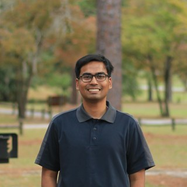

These are the people I've worked with. I owe a lot of what I know to them.

## <i class="fas fa-chalkboard-user"></i> Supervisors

Dr. Mohammad Shahidur Rahman

Professor and Head, Department of Civil and Environmental Engineering, SUST

Supervised my undergraduate thesis on bio-cementation with <em>Arthrospira platensis</em>.

<a href="https://www.sust.edu/departments/cee/faculty/msrahman-cee@sust.edu"><i class="fas fa-building-columns"></i> Faculty page</a>
<a href="https://orcid.org/0009-0002-1862-2978"><i class="ai ai-orcid"></i> ORCID</a>

Dr. Shriful Islam

Professor, Department of Civil and Environmental Engineering, SUST

Supervised my work on soil stabilization with waste materials, fiber and fly ash.

<a href="https://www.sust.edu/departments/cee/faculty/sharif-cee@sust.edu"><i class="fas fa-building-columns"></i> Faculty page</a>
<a href="https://orcid.org/0000-0002-8148-4750"><i class="ai ai-orcid"></i> ORCID</a>

## <i class="fas fa-people-group"></i> Collaborators and Colleagues

Raied Ahmed Nishat

Civil engineering researcher, Georgia Southern University

Joint first author with me on the Bayesian PINN slope stability paper.

<a href="https://www.linkedin.com/in/raiedahmed"><i class="fab fa-linkedin"></i> LinkedIn</a>
<a href="https://orcid.org/0009-0006-0448-3486"><i class="ai ai-orcid"></i> ORCID</a>

Ananya Soheli Chowdhury

Lecturer, Department of Civil and Environmental Engineering, SUST

Co-author on our desiccation cracking and soil stabilization papers.

<a href="https://www.sust.edu/departments/cee/faculty/ananya-cee@sust.edu"><i class="fas fa-building-columns"></i> Faculty page</a>
<a href="https://orcid.org/0009-0009-5338-8276"><i class="ai ai-orcid"></i> ORCID</a>

Junaidul Islam

PhD student, Geotechnical Engineering, Auburn University

Co-author on our crushed glass, desiccation cracking and soil stabilization papers.

<a href="https://www.linkedin.com/in/junaidulislam-sust-bd/"><i class="fab fa-linkedin"></i> LinkedIn</a>
<a href="https://orcid.org/0000-0002-9415-8962"><i class="ai ai-orcid"></i> ORCID</a>

Amit Chakraborty

Assistant Professor and Head (Acting), Department of Civil Engineering, Leading University

My department head and colleague at Leading University.

<a href="https://lus.ac.bd/author/amit/"><i class="fas fa-building-columns"></i> Faculty page</a>
<a href="https://www.researchgate.net/profile/Amit-Chakraborty-7"><i class="fab fa-researchgate"></i> ResearchGate</a>

