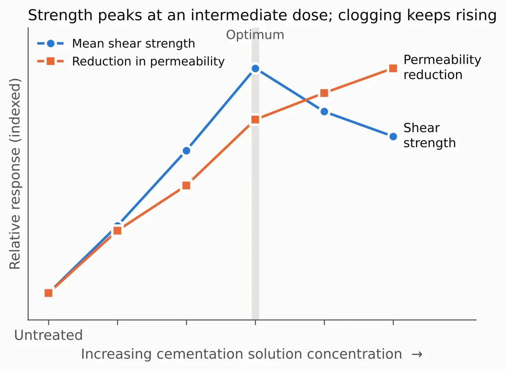
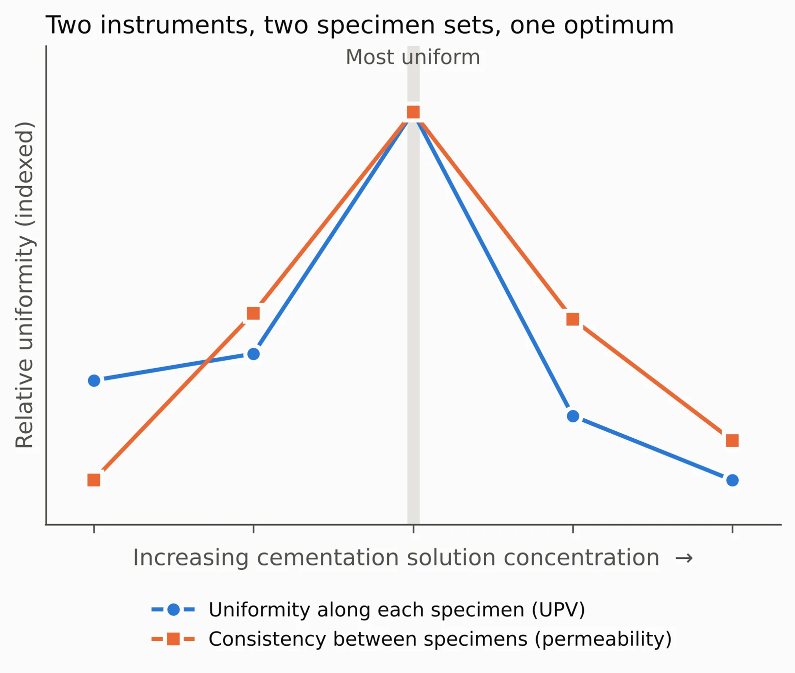
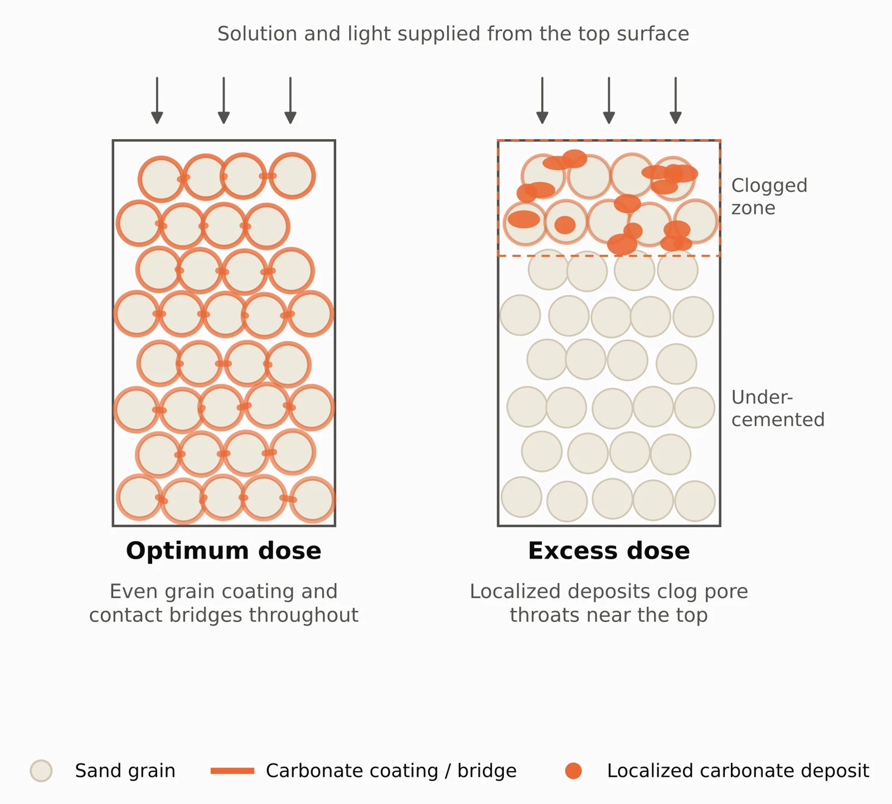
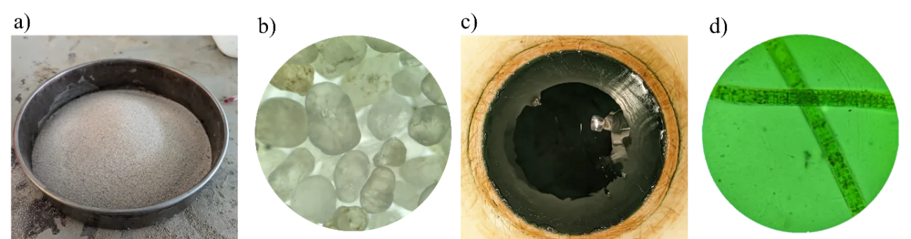

[← Back to Research Projects](/research-projects/)

---

## Research in Brief

This project began as my undergraduate thesis at SUST. It examines whether the cyanobacterium *Arthrospira platensis* can cement loose sand through microbially induced carbonate precipitation (MICP). Most MICP studies rely on ureolytic soil bacteria, so a photosynthetic alternative has received comparatively little attention, particularly in Bangladesh.

Ottawa sand was treated by surface percolation with the culture and an equimolar calcium chloride and urea solution at five concentrations, from 0.20 to 1.00 M. The treated specimens were tested for permeability, direct shear strength over a range of normal stresses, and ultrasonic pulse velocity (UPV) along their height. Optical microscopy and SEM-EDS were used to examine how the carbonate was distributed and how it bonded the grains.

The early results from this work were presented at ICACE 2024. The journal manuscript extends that study considerably, with a wider range of concentrations, direct shear and UPV testing, a fuller statistical treatment and a microstructural reanalysis.

**Research Period:** 2023 to 2024 (laboratory work) &nbsp;|&nbsp; **Funding:** SUST Research Centre (AS/2023/1/19) &nbsp;|&nbsp; **Status:** First-author manuscript under review at *Geosystems and Geoenvironment* &nbsp;|&nbsp; **Supervisor:** Dr. Mohammad Shahidur Rahman

---

## Analysis

- **Permeability.** Hydraulic conductivity was corrected to a standard temperature, and several established porosity–permeability models were compared against the measurements. The comparison indicates how the precipitate is distributed within the pore space, rather than only how much it reduces flow. The variation between replicate specimens was also used as a measure of how consistently the treatment performed.
- **Shear strength.** With a limited number of tests per treatment, a hierarchical Bayesian model was used to estimate the strength parameters and their uncertainty from all treatments together. Treatments were also compared on mean measured strength, which does not depend on extrapolating the strength envelope to zero normal stress.
- **Uniformity.** UPV measurements along each specimen were used to check where the cementation formed and how evenly it was distributed.
- **Microscopy.** Optical image analysis was checked for sensitivity to its processing settings, and the SEM comparison was carried out on the original, unprocessed images.

---

## Key Findings

- *Arthrospira platensis* produced calcium carbonate within the sand and bonded the grains, confirming its potential as an MICP bioagent.
- Shear strength peaked at an intermediate concentration, while the reduction in permeability continued to increase at higher concentrations.
- At the optimum concentration, cementation was most uniform both along each specimen and between specimens. Two independent measurements, on different specimen sets, pointed to the same optimum.
- At high concentrations, carbonate accumulated near the treated surface and clogged the pores there, leaving the lower part of the specimen under-cemented. In this range, the residual friction angle fell below that of untreated sand.
- The permeability analysis supports this interpretation: the measured behaviour is consistent with pore-throat clogging rather than an even coating of the grains.

---

## Figures

<h3>Strength and Permeability</h3>

Shear strength rises to a peak at an intermediate concentration and then declines, while the reduction in permeability keeps increasing. Values are shown as indexed relative responses.

Figure: Shear strength and permeability reduction against cementation solution concentration

<h3>Uniformity of Cementation</h3>

Uniformity along each specimen, from UPV, and consistency between specimens, from permeability, both peak at the same concentration. The two measurements come from different instruments and different specimen sets.

Figure: Uniformity of cementation from UPV and from permeability

<h3>Proposed Mechanism</h3>

At the optimum dose, carbonate coats the grains and forms bridges at grain contacts throughout the specimen. At an excess dose, localized deposits clog the pore throats near the treated surface, and the solution cannot reach the lower part of the specimen.

Figure: Carbonate distribution at the optimum dose and at an excess dose

<h3>Test Materials</h3>

(a) Ottawa sand, (b) the sand at 40× magnification, showing its rounded grains, (c) the <em>Arthrospira platensis</em> culture, and (d) the culture at 40× magnification, showing its filaments.

Figure: Ottawa sand and the cyanobacterial culture

---

## Related Publications

- Hasnat, N., Rahman, M. S., and Nahid, M. H. *Experimental study of Arthrospira platensis as an alternative bioagent for microbially induced carbonate precipitation.* Under review, Geosystems and Geoenvironment.
- Rahman, M. S., Hasnat, N., and Nahid, M. H. (2024). *Bio-cementation of sand through cyanobacteria-induced calcite precipitation for sustainable soil stabilization.* Proceedings of ICACE 2024, CUET, 1351–1358. This conference paper reported the preliminary stage of the work, based on unconfined compression testing at four concentrations.
