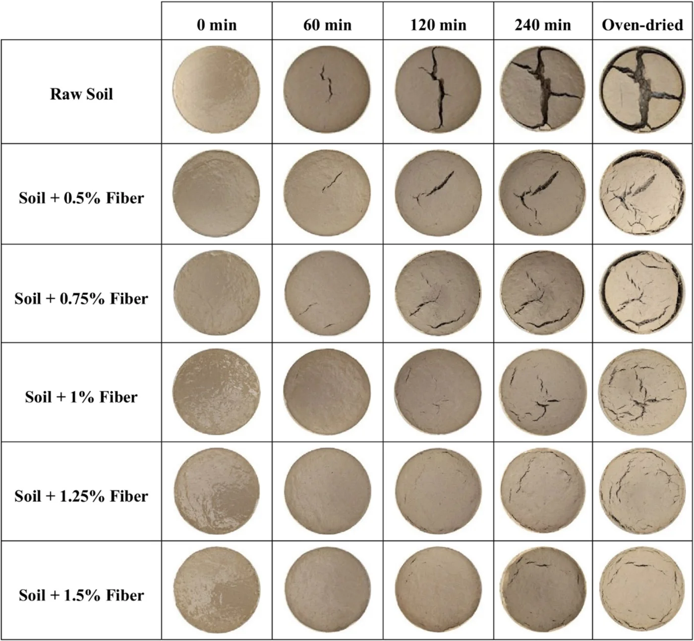
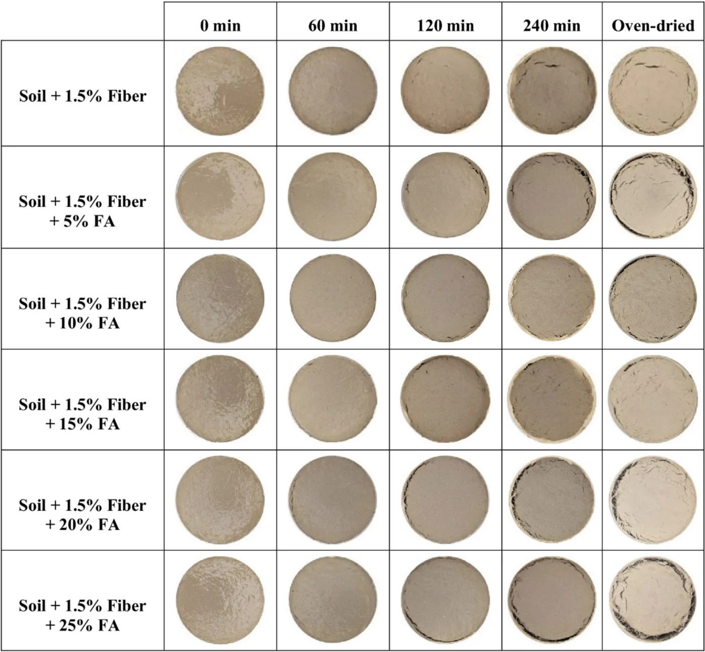
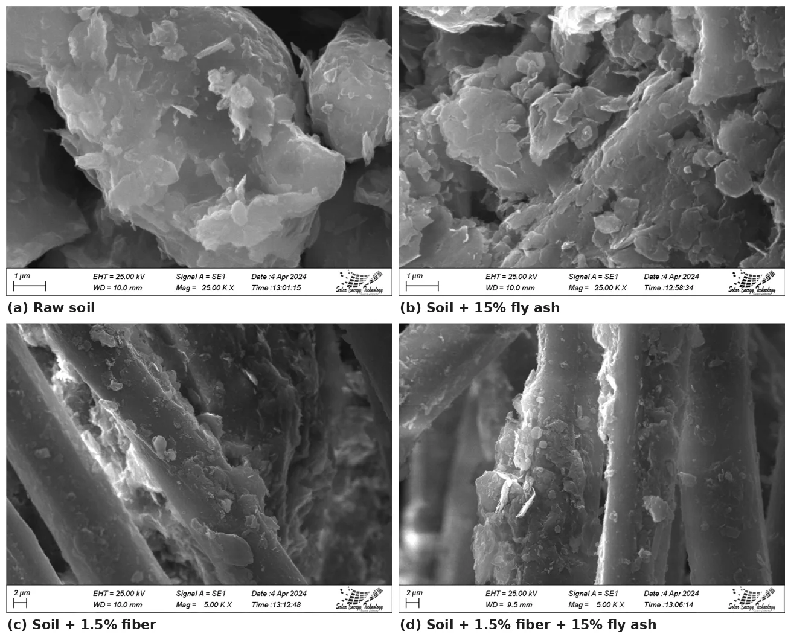

[← Back to Research Projects](/research-projects/)

---

## Research in Brief

Flood-control embankments in the haor wetlands of northeastern Bangladesh are built largely from fine-grained local soil. During dry periods this soil shrinks and cracks, and the cracks allow rapid seepage and erosion when flash floods arrive. This study examined whether polyester fiber and Class F fly ash, both inexpensive and locally available, can reduce desiccation cracking in embankment soil collected from Sunamganj.

The soil was a sandy elastic silt (MH). Slurry specimens were dried under a halogen lamp, and cracking was recorded at regular intervals. Surface cracking was measured from binarized images in ImageJ, and crack volume from 3D photogrammetric models built in Agisoft Metashape. The programme ran in three stages:

1. **Raw soil.** The cracking behaviour of the untreated soil was established at different initial water contents and at two drying temperatures, one representing current summer conditions and one representing a more extreme future climate.
2. **Fiber.** Polyester fiber was added at 0.5 to 1.5% of the dry soil weight to find the most effective content.
3. **Fiber and fly ash.** With the fiber content fixed at its optimum, fly ash was added at 5 to 25%.

The soil with the optimum mix was then compared with the raw soil through Atterberg limits, compaction, expansion index, free swell index, unconfined compression and SEM tests.

**Research Period:** 2023 to 2024 &nbsp;|&nbsp; **Funding:** SUST Research Centre &nbsp;|&nbsp; **Status:** Published in *Geotechnical and Geological Engineering* (2025) &nbsp;|&nbsp; **My role:** Desiccation test setup, image-based and photogrammetric crack measurement

---

## Key Findings

- **Raw soil.** Cracking increased with both initial water content and drying temperature. The cracks formed simple X- and T-shaped patterns, with fewer secondary cracks than are typical of clays.
- **Fiber alone.** Fiber broke up the crack network. Instead of one wide crack, the reinforced soil developed narrow, shallow microcracks. At 1.5% fiber, surface cracking fell by about 85% and crack volume by about 92%.
- **Fiber with fly ash.** Adding 15% fly ash to 1.5% fiber reduced surface cracking by **96.4%** and crack volume by **97.8%**. Beyond this content, additional fly ash began to increase cracking again.
- **Soil properties.** The optimum mix reduced the plasticity index by **34%**, the free swell index by **47%** and the expansion index by **60%**, and increased the unconfined compressive strength by **45%**.
- **Mechanism.** SEM images showed the soil adhering to the fiber surface and fly ash clustering between soil particles, which together explain the reduced cracking.

---

## Figures

<h3>Crack Development with Fiber</h3>

Specimens photographed during drying and after oven drying. The raw soil develops a single wide crack network, while increasing fiber content restricts the cracks to fine, discontinuous fissures.

Figure: Desiccation crack patterns for soil with 0 to 1.5% polyester fiber

<h3>Crack Development with Fiber and Fly Ash</h3>

With 1.5% fiber, adding fly ash reduces cracking further up to 15%. At higher contents, cracking starts to increase again.

Figure: Desiccation crack patterns for soil with 1.5% fiber and 5 to 25% fly ash

<h3>Crack Measurement from Images</h3>

Specimens were converted to binary images in ImageJ so that the cracked area could be measured directly.

Figure: Binarized crack images used to measure surface cracking

<h3>3D Photogrammetric Models</h3>

Thirty to fifty photographs of each dried specimen were combined into a 3D model in Agisoft Metashape, which allowed crack volume to be measured as well as crack area.

Figure: 3D model of a cracked specimen generated in Agisoft Metashape

<h3>Unconfined Compressive Strength</h3>

The optimum mix raised the peak unconfined compressive strength from about 219 kPa to about 317 kPa, and the fibers can be seen bridging the failure plane.

Figure: Stress–strain response of the original and modified soil

<h3>Microstructure</h3>

SEM images of the raw soil and of soil with fly ash, fiber, and both. Soil particles adhere to the fiber surface, and fly ash clusters fill the spaces between particles.

Figure: SEM images of the raw and treated soil

Figures reproduced from Islam et al. (2025), <em>Geotechnical and Geological Engineering</em>, 43, 277.

---

## Publications

**Journal article**

Islam, S., Chowdhury, A. S., Hasnat, N., Alam, M. J. B., and Islam, J. (2025). Mitigating desiccation cracking in embankment soil using polyester fiber and fly ash. *Geotechnical and Geological Engineering*, 43, 277. [doi:10.1007/s10706-025-03224-w](https://doi.org/10.1007/s10706-025-03224-w)

**Conference paper**

Islam, S., Chowdhury, A. S., Hasnat, N., Islam, J., Alam, M. J. B., and Saha, P. (2024). Assessing fiber-reinforcement for reduction of desiccation-induced cracking of embankment soil. *Proceedings of the International Conference on Advances in Civil Engineering (ICACE 2024)*, CUET, Chattogram, Bangladesh, 1244–1251. This paper reported the earlier stage of the work, on fiber reinforcement alone.
