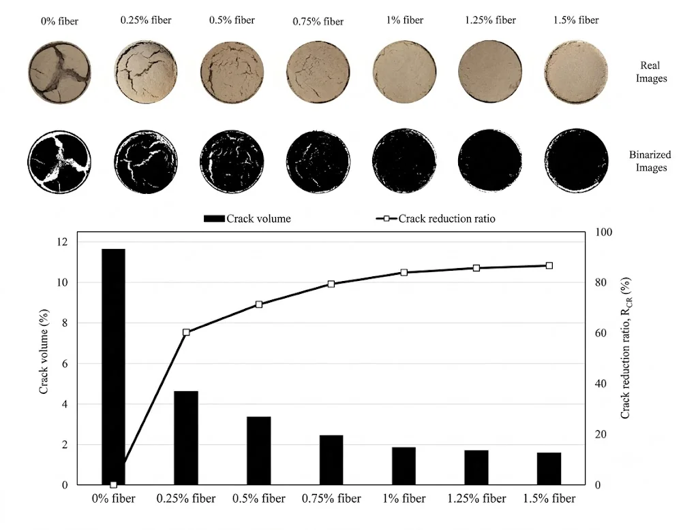
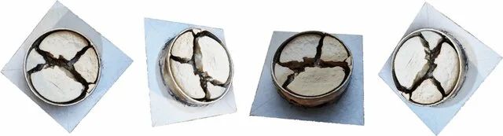
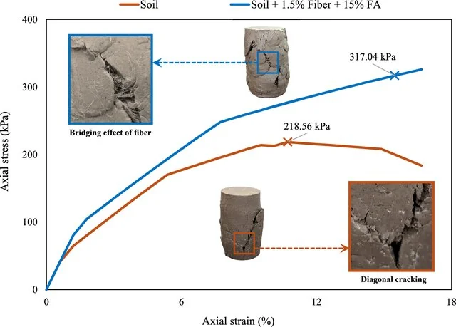

[← Back to Research Projects](/research-projects/)

---

## Research in Brief

Embankment soil cracks as it dries. The cracks let water in during floods and speed up erosion. In this project we tried to reduce the cracking with fiber, with and without fly ash.

We did it in two phases. First, we tested polypropylene fiber at 0.25 to 1.5%. Then we tested polyester fiber with 15% fly ash. We measured Atterberg limits, compaction, free swell, CBR and UCS, and looked at the microstructure with SEM. To measure crack volume, we made 3D models of the specimens.

**Research Period:** 2023 – 2024 &nbsp;|&nbsp; **Status:** Published in *Geotechnical and Geological Engineering* (2025) &nbsp;|&nbsp; **Affiliation:** Department of Civil and Environmental Engineering, SUST, Bangladesh

---

## Key Findings

- 1.5% fiber cut the surface crack ratio by **96.4%** and the crack volume ratio by **97.8%**.
- 1.5% polyester fiber with 15% fly ash gave the **highest UCS, 317.04 kPa**. That's 45% more than the untreated soil.
- The plasticity index fell by **33.6%**, the expansion index by **60%** and the free swell index by **47.3%**.
- SEM showed the **fibers bridging soil grains** and **fly ash binding particles together**.
- 3D models from Agisoft Metashape gave crack volumes that matched the surface measurements.

---

## Experimental Analysis

<h3>Crack Volume Reduction with Fiber Reinforcement</h3>

Cracked specimens at fiber contents from 0 to 1.5%, with the binary images we used to measure crack area. Crack volume fell as we added more fiber, by up to 97.8% at 1.5%.

Figure: Crack volume reduction achieved using different proportions of fiber

<h3>3D Photogrammetric Modeling</h3>

3D models of the cracked specimens made in Agisoft Metashape 2.0.1. These let us measure crack volume, not just crack area.

Figure: 3D model of cracked soil specimen generated in Agisoft Metashape 2.0.1

<h3>Axial Stress–Strain Behavior</h3>

UCS of the untreated soil and the best mix (1.5% polyester fiber and 15% fly ash). Peak UCS went from 218.56 kPa to 317.04 kPa. You can see the fibers bridging the failure plane.

