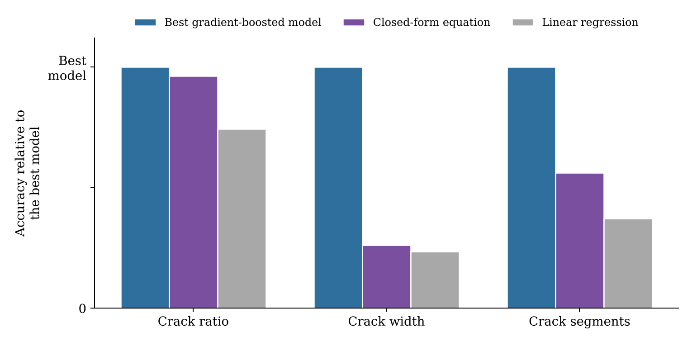
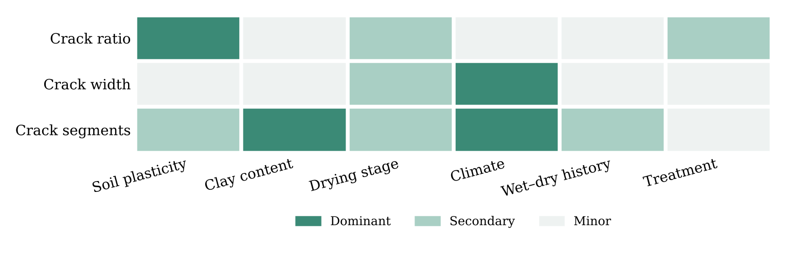

[← Back to Research Projects](/research-projects/)

---

## Research in Brief

The experimental desiccation work told me how much a given additive suppresses cracking in one soil, under one drying regime. It didn't tell me which variables are actually doing the work once you look across many soils, climates and treatments at once, and that is the question a practising engineer needs answered before choosing a fix.

So I compiled several hundred desiccation test specimens from published studies into one dataset. Each specimen is described by its soil (clay content and plasticity), the drying conditions (temperature and humidity), its wetting–drying history, the stage of drying, and the treatment applied, from raw soil through fiber reinforcement to biomineralization. Three measures of cracking are predicted separately: crack ratio, average crack width and the number of crack segments.

The work runs in two steps. First, gradient-boosted tree models learn the relationship as accurately as the data allows. Then genetic-programming symbolic regression turns what those models learned into closed-form equations that can be evaluated by hand or in a spreadsheet, with no trained model needed.

**Research Period:** June 2026 – Present &nbsp;|&nbsp; **Status:** Ongoing

---

## Methodology

1. **Data compilation.** Desiccation test results gathered from published studies into a single, consistently formatted dataset, with duplicate and redundant descriptors screened out.

2. **Model training.** LightGBM, XGBoost and CatBoost, each tuned by grid search under 5-fold cross-validation, with native handling of the categorical inputs (drying stage and treatment type) instead of one-hot encoding. A random forest serves as the baseline. Outlier removal and target transformation are adopted only where they improve cross-validated accuracy.

3. **Evaluation.** Each crack measure is scored on a held-out test set, and the best model is selected separately for each one.

4. **Feature importance.** Permutation and gain importance identify which inputs each crack measure actually depends on.

5. **Categorical factors.** The best model generates a numerical factor for each drying stage and each treatment class, from its partial dependence, so that categorical inputs can enter an equation as plain numbers.

6. **Symbolic regression.** Genetic programming fits one equation per crack measure, using only the most important inputs and the model-generated factors, with a parsimony penalty that keeps the equations short enough to read.

---

## Key Findings

- The gradient-boosted models improve on the random-forest baseline for every crack measure, and no single library wins on all three.
- **Each crack measure is governed by a different driver.** How much of the surface cracks, how wide the cracks open and how many separate cracks form do not respond to the same variables, which is why lumping them into a single "cracking" index loses information.
- For crack ratio, the closed-form equation keeps almost all of the accuracy of the best boosted model and clearly beats linear regression.
- Crack width and crack segment count are harder to compress into a short equation, which says something about how nonlinear those two responses are.
- The treatment applied matters, but less than soil and climate for most measures.

---

## Analysis

<h3>Equation Versus Model Accuracy</h3>

Accuracy of the closed-form equation and of linear regression on the held-out test set, shown relative to the best gradient-boosted model for each crack measure. For crack ratio, the equation gives up very little against the full model.

Figure: Accuracy relative to the best gradient-boosted model, per crack measure

<h3>What Drives Each Crack Measure</h3>

Permutation importance from the best model for each crack measure, with the inputs grouped by what they describe and ranked as dominant, secondary or minor. The dominant group changes from one crack measure to the next.

Figure: Relative importance of each group of inputs, per crack measure

---

## Why this matters

This builds directly on the experimental side of my desiccation work. The laboratory studies measured how much fiber, fly ash and lime suppress cracking in haor embankment soil; this one asks which of those levers matter most once soil, climate and treatment are varied together, and gives the answer in a form that can be used without running a model.

Related: [Mitigating desiccation-induced cracking with fiber reinforcement and fly ash](/research-projects/desiccation-cracking/) and [remediation of desiccation-ridden embankment soil using waste plastic fiber, fly ash and lime](/research-projects/embankment-soil/).
