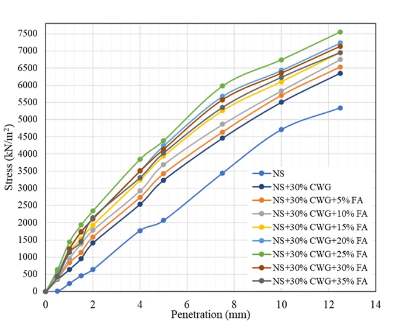
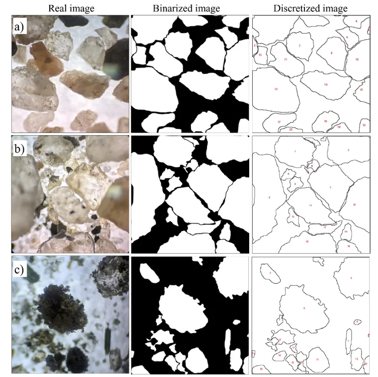
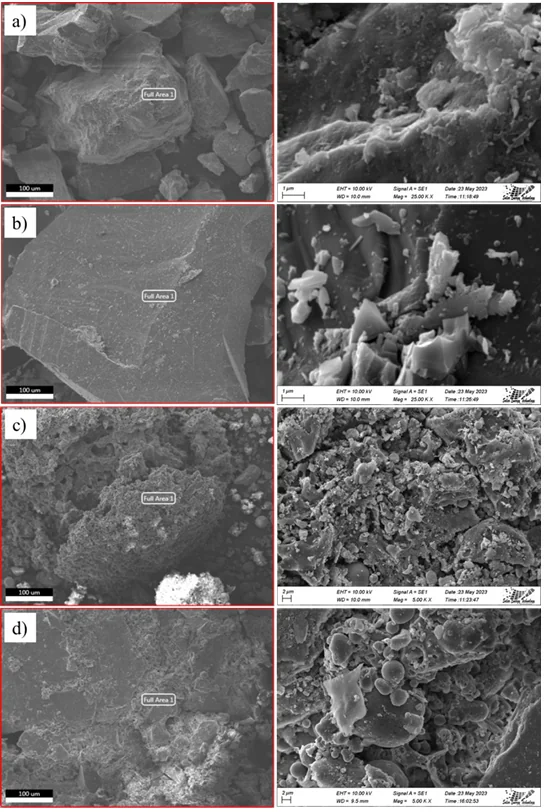

[← Back to Research Projects](/research-projects/)

---

## Research in Brief

Natural sand is extracted in very large quantities for construction, and in Bangladesh this is contributing to riverbed depletion. At the same time, waste glass is difficult to dispose of. Since sand and glass are chemically similar, this study examined whether fine crushed waste glass (CWG) can partially replace natural sand in pavement subgrade and subbase layers, and whether fly ash can then stabilize the mixture.

The work was carried out in two stages:

1. **Glass replacement.** Natural sand was replaced with sand-sized crushed glass at 5 to 35% by dry weight, in steps of 5%, to find the optimum glass content.
2. **Fly ash stabilization.** The optimum sand–glass mix was stabilized with Class C fly ash at 5 to 35%.

Each mix was assessed through compaction, direct shear and California Bearing Ratio (CBR) tests. Particle roundness was measured from microscope images, and the microstructure was examined by SEM-EDS.

This was my first research project, and it introduced me to planning and running a full laboratory study.

**Research Period:** 2022 to 2023 &nbsp;|&nbsp; **Funding:** SUST Research Centre &nbsp;|&nbsp; **Status:** Published in *Heliyon* (2024) &nbsp;|&nbsp; **My role:** Laboratory testing, mix optimization and SEM-EDS characterization

---

## Key Findings

- **Compaction.** Crushed glass increased the maximum dry density of the sand and lowered its optimum moisture content. Fly ash had the opposite effect.
- **Optimum mix.** The best performance was obtained with 30% glass replacement stabilized with 25% fly ash.
- **Shear strength.** Glass mainly increased the friction angle. With fly ash, the mix gained cohesion (about 16 kPa, from zero for clean sand), the friction angle rose by about 29%, and the shear strength at high normal stress increased by about 56%.
- **Bearing capacity.** CBR rose by about 13% with glass alone and by about 44% with glass and fly ash.
- **Particle shape and microstructure.** Glass and fly ash made the particles less rounded, which improves interlocking. SEM showed fly ash binding the grains and filling the pores.

---

## Figures

<h3>CBR Response</h3>

Load–penetration curves for natural sand, the sand–glass mixes and the fly ash-stabilized mixes.

Figure: CBR response of the sand, glass and fly ash mixes

<h3>Particle Roundness</h3>

Microscope images were converted to binary form to measure particle roundness. Roundness decreased as glass and then fly ash were added, which supports the gain in friction angle.

Figure: Particle roundness analysis in ImageJ

<h3>Microstructure</h3>

SEM images of the crushed glass, which has rough and notched surfaces, of the fly ash, and of the optimum mix, where fly ash binds the grains and fills the pores.

Figure: SEM images of the materials and the optimum mix

---

## Publications

Islam, S., Islam, J., Alam, M. J. B., Chowdhury, A. S., Hasnat, N., Rafe, M. T. A., and Jubair, S. A. A. (2024). Partial replacement of sand by fine-grained crushed waste glass along with fly ash stabilization for geotechnical applications in pavement. *Heliyon*, 10(19), e38754. [doi:10.1016/j.heliyon.2024.e38754](https://doi.org/10.1016/j.heliyon.2024.e38754)

An earlier stage of this work, on glass replacement alone, was presented at ICCESD 2024.
