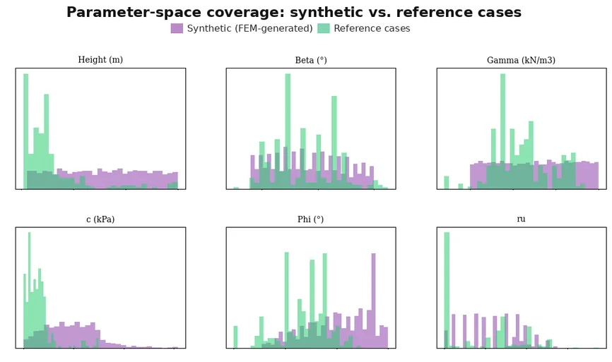
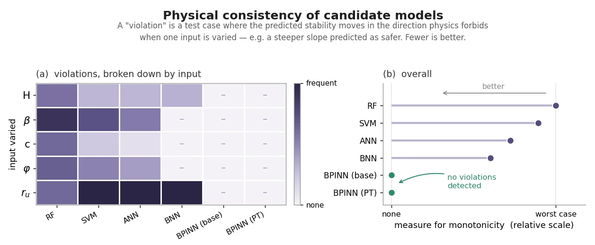

[← Back to Research Projects](/research-projects/)

---

## Research in Brief

Machine learning models for slope stability are increasingly common, but many of them give answers that contradict basic soil mechanics. For example, a model could fit a slope database well and still say a slope gets safer as it gets taller. This project tries to fix that.

I collected 275 circular-failure slope cases from 14 published sources. I removed duplicates and cases that didn't make physical sense, and kept 55 aside as a test set I never trained on. Then I automated 3,000 PLAXIS 2D strength-reduction runs with the Python scripting API. Getting this to run properly meant fixing arc-length control and mode-dependency problems. I used 2,000 of these runs to pretrain the network.

The model is a Bayesian physics-informed neural network. It is forced to respond in the right direction to six key parameters. This rule is built into the network, not added as a penalty during training, so every prediction follows it, even outside the training range. Standard models like random forest, SVM, ANN and BNN scored slightly higher on accuracy, but all of them broke the rule. Pretraining on the FEM data improved accuracy in all five cross-validation folds.

**Research Period:** December 2025 – August 2026 &nbsp;|&nbsp; **Status:** Manuscript in preparation. Joint first author with R. A. Nishat. I'm the corresponding author.

---

## Key Findings

- The B-PINN had **zero rule violations**. The standard models broke the rule in **19 to 31%** of tests outside the training range.
- McNemar's test found **no significant difference** in accuracy between any of the 15 model pairs. So accuracy alone can't tell these models apart.
- Conflicting labels in the database limit any model of this kind to about **94.6% accuracy**.
- SHAP showed that the unconstrained BNN gave **lower failure probability for higher pore pressure** (Spearman ρ = −0.90), which is physically wrong.
- On an 88,200-point design chart, the unconstrained network said failure gets less likely as the slope gets taller over **46% of the chart**. The B-PINN can't do this.

---

## Experimental Analysis

<h3>Parameter-Space Coverage</h3>

The 2,000 FEM runs and the 275 field cases compared across the six inputs: height, slope angle, unit weight, cohesion, friction angle and pore pressure ratio. The FEM data covers a wider range, which is what makes it useful for pretraining.

Figure: FEM runs vs. field cases across the six inputs

<h3>Physical Consistency of Candidate Models</h3>

(a) How often each model broke the rule for each input. Darker means more often. The B-PINN columns are blank because it can't break the rule. (b) Overall rule violations on a relative scale. Both B-PINN versions are at zero and every standard model is above it.

