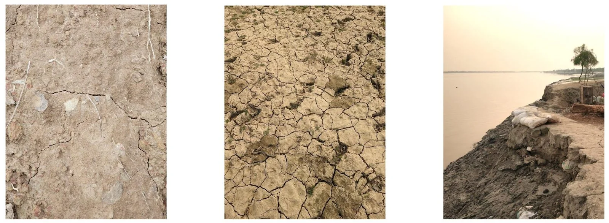
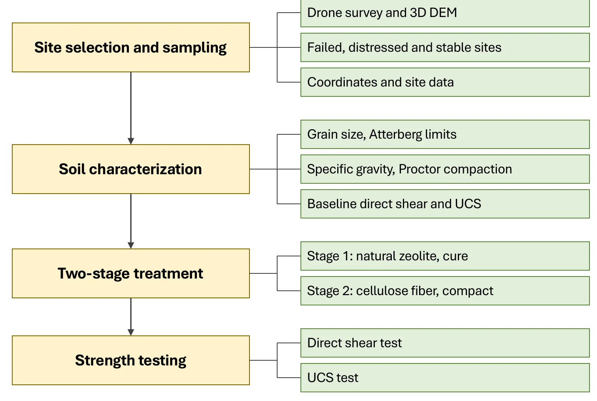

[← Back to Research Projects](/research-projects/)

---

## Research in Brief

I'm the Principal Investigator on this project. Emad Ahmed, a Lecturer at Leading University, is the Co-Investigator. CRISP at Leading University funds it, and I supervise two B.Sc. students on the lab and modelling work.

The flood embankments around the haor in Sunamganj are made of weak, fine-grained soil. They crack in the dry season, the monsoon water gets into the cracks, and parts of them have to be rebuilt almost every year. Cement and lime can fix the soil, but they're expensive to bring in and have a high carbon cost.

We're testing whether natural zeolite and cellulose fiber can do the job instead. Zeolite goes in first and the soil is left to cure. Fiber goes in second, to hold the treated soil together. Each one has a different job, so we add them one after the other instead of mixing them at once.

The project has four parts. A drone survey of the embankments helps us pick where to sample. Lab tests on that soil find the best mix. PLAXIS 2D models check whether the lab results hold up for a full embankment. A life cycle assessment compares the carbon cost with cement and lime.

**Research Period:** July 2026 – June 2027 &nbsp;|&nbsp; **Status:** Ongoing, funded by CRISP &nbsp;|&nbsp; **Role:** Principal Investigator

<em>The problem in the field: desiccation cracks in the embankment soil and a failed embankment section along the haor.</em>

---

## Methodology

<em>The lab programme, from choosing sites to strength testing.</em>

1. **Choosing sites.** We fly a drone (DJI Neo 2) along the embankment and build a 3D elevation model in photogrammetry software and QGIS. This shows the steep and damaged sections. We then take soil from a failed site, a damaged site and a stable site, and record where each sample came from.

2. **Testing the raw soil.** Grain size, Atterberg limits, specific gravity, Proctor compaction, and direct shear and UCS on the untreated soil.

3. **Treating the soil.** First we add natural zeolite at 5 to 20% of the dry weight and let it cure. Then we add cellulose fiber at 0.25 to 1% and compact the soil. Samples cure for 7, 14 and 28 days.

4. **Strength tests.** Direct shear and UCS on every mix. These give the best zeolite dose, the best fiber dose on top of it, and how strength changes with curing time.

5. **Looking inside.** SEM-EDS on the untreated and best treated samples at BCSIR, Dhaka. This shows how the soil structure changes and how the fiber bonds to the soil.

6. **Modelling the embankment.** We put the lab values (unit weight, cohesion, friction angle, stiffness and permeability) into PLAXIS 2D. Then we compare the factor of safety and deformation of the untreated and treated embankment.

7. **Carbon cost.** A cradle-to-gate life cycle assessment in OpenLCA compares untreated soil, treated soil and a standard stabilizer on global warming potential and embodied energy.

We won't pick the best mix on strength alone. Strength, the SEM results, the factor of safety and the carbon cost all count. We may adjust the sites, doses and curing times after the first trial mixes.

---

## What we intend to find out

- Does adding zeolite first and fiber second make the soil stronger in shear and UCS, and what are the best doses?
- What does SEM-EDS show about how zeolite changes the soil and how the fiber bonds to it?
- Do the lab gains give a higher factor of safety for a real embankment section in PLAXIS 2D?
- How does the carbon cost compare with cement or lime for the same soil?

---

## Why this approach

We based the order and the doses on earlier studies. When fiber was added to soil already treated with a chemical additive, strength went up at each stage. Lime has also been shown to protect natural fiber from rotting. Zeolite has worked at around 5 to 13% in past studies, and natural fiber usually works best between 0.4 and 1%. Above that, the fibers clump and strength drops. Zeolite-treated soil keeps getting stronger from 7 to 28 days, so we picked those curing times.

The soil comes from the same kind of haor embankment as my earlier cracking studies. Those studies showed how badly this soil cracks and how much fiber and fly ash help. This project asks if we can get the same benefit with materials that don't involve plastic or cement.

Related: [Remediation of desiccation-ridden embankment soil using waste plastic fiber, fly ash and lime](/research-projects/embankment-soil/) and [mitigating desiccation-induced cracking with fiber reinforcement and fly ash](/research-projects/desiccation-cracking/).

---

## Grant

**Principal Investigator:** Evaluating the Effectiveness of Natural Zeolite and Cellulose Fiber Addition in Sunamganj Embankment Soil: Experimental Investigation, Life Cycle Assessment, and Numerical Modelling. Centre for Research, Innovative Studies and Planning (CRISP), Leading University, 2026. Co-Investigator: Emad Ahmed.
