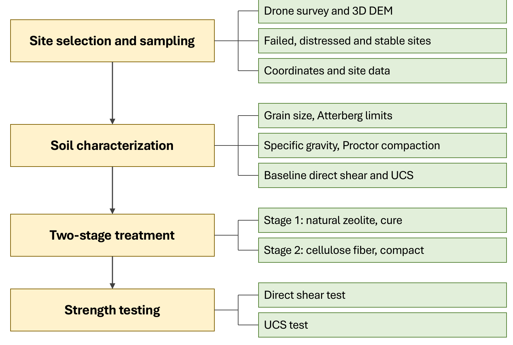

[← Back to Research Projects](/research-projects/)

---

## Research in Brief

I'm the Principal Investigator on this project, with Emad Ahmed (Lecturer, Leading University) as Co-Investigator. It is funded by the Centre for Research, Innovative Studies and Planning (CRISP) at Leading University, and I'm supervising two B.Sc. students on the testing and modelling work.

The flood-control embankments around the haor wetlands in Sunamganj get rebuilt more or less every year. The soil is weak and fine-grained, it dries out and cracks through the summer, and then the monsoon finds the cracks. Most of the fixes that get proposed for this soil are cement or lime, which work but are expensive to truck in and carry a carbon cost that nobody accounts for.

This study asks whether adding natural zeolite first and cellulose fiber second can make that soil stronger and more stable, at a lower environmental cost than cement or lime. Zeolite goes in at the first stage and is left to cure, so the soil matrix is treated before anything else. Cellulose fiber goes in at the second stage, mixed into the already-treated soil and compacted, to hold it together mechanically. The two additives are meant to do different jobs, so they get dosed in sequence rather than mixed and optimised together.

Four things run alongside each other. A drone survey of the embankments, to pick the sampling sites from what the sections actually look like in the field. A laboratory programme on soil taken from those embankments. Finite element modelling of the treated embankment section, to see whether the laboratory gains hold up at the scale the material is actually used. And a life cycle assessment, because "sustainable" should mean something measurable rather than a word in the abstract.

**Research Period:** July 2026 – June 2027 &nbsp;|&nbsp; **Status:** Ongoing, funded by CRISP &nbsp;|&nbsp; **Role:** Principal Investigator

<em>The problem in the field: desiccation cracks in the embankment soil and a failed embankment section along the haor.</em>

---

## Methodology

<em>The experimental programme, from site selection to strength testing.</em>

1. **Site selection and sampling.** A drone survey (DJI Neo 2, processed by photogrammetry and in QGIS) builds a 3D DEM of the embankment to identify the critical slopes. Soil is then sampled from failed, distressed and stable sites, with coordinates and site data recorded for each.

2. **Soil characterization.** Grain size distribution, Atterberg limits, specific gravity and Proctor compaction, along with baseline direct shear and UCS on the untreated soil.

3. **Two-stage treatment.** Stage 1 adds natural zeolite at 5–20% by dry weight, followed by curing. Stage 2 adds cellulose fiber at 0.25–1.0% by dry weight, followed by compaction. Specimens are cured for 7, 14 and 28 days.

4. **Strength testing.** Direct shear and UCS on every mix, to find the optimum zeolite dosage, the optimum fiber dosage on top of it, and how strength develops with curing time.

5. **Mechanism.** SEM-EDS on untreated and optimally treated specimens, at the Industrial Physics Division, BCSIR, Dhaka, to look at the soil fabric, the fiber–matrix interface and the elemental changes behind the strength gain.

6. **Numerical validation.** Unit weight, cohesion, friction angle, stiffness and permeability from the laboratory programme go into PLAXIS 2D models of the untreated and treated embankment sections, comparing factor of safety and deformation.

7. **Life cycle assessment.** A cradle-to-gate LCA in OpenLCA, comparing untreated soil, treated soil and a conventional stabilizer on global warming potential and embodied energy.

The optimum mix is not picked on strength alone. It is chosen on strength gain, microstructural evidence, factor of safety and environmental impact taken together. The exact sites, dosage ranges, staging interval and curing schedule will be refined during the trial mixes.

---

## What we intend to find out

- Whether the two-stage sequence, zeolite first and fiber second, gives higher shear strength and UCS than the untreated soil, and what the optimum dosage and staging are.
- What SEM-EDS shows about how the zeolite changes the soil matrix and how the fiber bonds to it.
- Whether the laboratory gains translate to a higher factor of safety for a real embankment cross-section in PLAXIS 2D.
- What the environmental cost actually is, against conventional stabilization of the same soil.

---

## Why this approach

The sequence and the dosage ranges come from the literature rather than from guesswork. Studies that added fiber to soil already treated with a chemical additive got higher strength at each stage than the additive alone, and lime treatment has been shown to protect natural fiber from degrading. Zeolite has been effective at 5–13% across studies, alone, with cement and with fiber, and natural fiber optima sit between roughly 0.4% and 1%, with strength falling off above that as the fibers start to cluster. Zeolite-treated soil keeps gaining strength from 7 to 28 days, which is where the curing schedule comes from.

The soil comes from the same class of haor embankments as my earlier desiccation work. That work established how badly this soil cracks and how much fiber and fly ash can do about it. This one asks whether it can be done with materials that don't carry a plastic or a clinker cost.

Related: [Remediation of desiccation-ridden embankment soil using waste plastic fiber, fly ash and lime](/research-projects/embankment-soil/) and [mitigating desiccation-induced cracking with fiber reinforcement and fly ash](/research-projects/desiccation-cracking/).

---

## Grant

**Principal Investigator** — Evaluating the Effectiveness of Natural Zeolite and Cellulose Fiber Addition in Sunamganj Embankment Soil: Experimental Investigation, Life Cycle Assessment, and Numerical Modelling. Centre for Research, Innovative Studies and Planning (CRISP), Leading University, 2026. Co-Investigator: Emad Ahmed.
